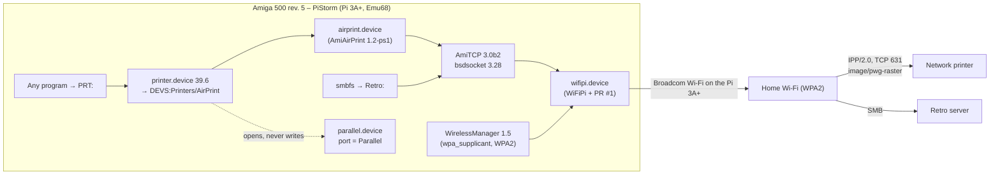

# Amiga 500 with PiStorm: Wi-Fi, RetroMount and direct IPP printing

An Amiga 500 rev. 5 with a PiStorm (Raspberry Pi 3A+ running Emu68):
- joins the home Wi-Fi with WPA2, using the Pi's own wireless chip;
- runs AmiTCP 3.0b2 on that link;
- mounts the retro server's Amiga library as `Retro:`;
- prints directly to a network printer over IPP, the same way as the [Amiga 600](../a600/).

| Part | Status |
|---|---|
| Wi-Fi (WPA2), static IP | ✅ **Proven on real hardware**, 13-10-2026. It needs a driver fix, see below. |
| RetroMount (`Retro:`) | ✅ Proven on real hardware, 13-10-2026 |
| Direct printing (AirPrintPS 1.0) | ✅ Proven on real hardware, 14-10-2026, tests A2–A6 and a reboot. The public ADF was retested in a clean emulator on 17-10-2026. |
| Plipbox fallback network (PlipNet 1.1, NOBURST) | ✅ Proven on real hardware, 17-10-2026. Burst mode does not work under Emu68, see [Issue 0002](../../docs/issues/0002-plipbox-noburst-pistorm.md). PlipNet itself is not part of this release. |
| Fallback printing through the Pi | 📋 Built and emulator-tested, **not activated, not part of this release** |
| WiFiNet package as a disk image | 🛠️ Not released yet; see [What is not released](#what-is-not-released-yet) |

> **This is the A500 rev. 5 only.** The A500 rev. 6A with the TerribleFire TF536 is a different machine with a different network route (Wodem/SLIP), documented separately in [`amiga/a500-tf536/`](../a500-tf536/).

## Hardware

| Item | Value |
|---|---|
| Machine | Amiga 500, board revision 5 |
| Accelerator | PiStorm with a Raspberry Pi 3A+, Emu68 |
| Video | Framethrower ⟨**TODO:** model, firmware and connection still to be documented⟩ |
| Kickstart / Workbench | Kickstart 45.66 (exec 45.25) with Workbench 3.1 modules (40.42); printer.device 39.6 |
| Network | the Pi 3A+'s Wi-Fi chip through `wifipi.device`. A Plipbox on the parallel port is the reserve route (PlipNet 1.1 with NOBURST, [Issue 0002](../../docs/issues/0002-plipbox-noburst-pistorm.md)). |
| Storage | `Work:` partition for the packages ⟨**TODO:** storage controller details⟩ |
| Floppy | Gotek, used to transfer the ADFs |

## Architecture



### Two fixes that make it work on OS 3.1

1. **Wi-Fi driver: [WiFiPi.device PR #1](https://github.com/michalsc/WiFiPi.device).** With the original driver (git `1752e4f`), WPA2 always failed with "Authentication with ff:ff:ff:ff:ff:ff timed out":
   - The second `S2_SETOPTIONS` call from WirelessManager wiped the join parameters.
   - The fix, upstream PR #1 by *tinic* (commit `aa07acb`), changes only the options the call actually names. It is not copied into this repository, because its licence terms are not established; see [`networking/wifi/`](../../networking/wifi/).
   - On the real A500 this gave `WPA: Key negotiation completed` and `CTRL-EVENT-CONNECTED` (CCMP).
   - The PR was still open upstream when this was written.
2. **Printer driver: AmiAirPrint 1.2-ps1.** Two problems in the Aminet release 1.2 under OS 3.1 with AmiTCP 3.0b2, both shown in the emulator:
   - **Library version.** AmiAirPrint asks for bsdsocket.library version 4, but AmiTCP 3.0b2 provides 3.28. The ps1 patch asks for version 3; every socket call it uses already exists there.
   - **DOS calls from a Task.** Under OS 3.1, printer.device runs the driver as an exec *Task*, and DOS calls from a Task hang. The driver read its settings and spooled to `T:` through DOS. The ps1 patch reads the settings only in a Process and spools in memory.
   - See [`printing/amiairprint/`](../../printing/amiairprint/).

### Why the printer port is *Parallel* here

On this machine Wi-Fi carries the network, so the parallel port is free. printer.device needs *some* port it can open; the AirPrint driver never sends data to it. **If you switch to the Plipbox reserve route (PlipNet), set the port to Serial**, as on the A600, because the Plipbox then holds the parallel port. On this particular A500 the serial *receive* side is defective (MC1489). That does not matter here, because printer.device only needs to open the port.

### About the name "AirPrint"

The names come from [AmiAirPrint](https://github.com/Andiweli/AmiAirprint). The route uses the open standards IPP/2.0 and PWG Raster, and is not supported or certified by Apple.

## Part 1 – Wi-Fi and RetroMount (WiFiNet)

WiFiNet installs into `Work:WiFiNet` and never touches `DEVS:Networks`, the startup-sequence or PlipNet. Nothing starts automatically.

| Icon | Function |
|---|---|
| **StartWiFi** | Runs these steps:<br/>1. Starts WirelessManager with `Work:WiFiNet/Prefs/Wireless.prefs`.<br/>2. Waits for the link with **WiFiLink**, a small tool written for this driver ([source](../../networking/wifi/WiFiLink.s)). It polls `S2_GETSIGNALQUALITY`, because WaitForLink 1.1 waits for `S2EVENT_LINKUP`, which wifipi does not support.<br/>3. Starts AmiTCP.<br/>4. Sets the fixed IP address with `ifconfig wifi0 <ip> netmask 255.255.255.0` and adds the default route.<br/>5. Pings the router and the server. |
| **RetroMount** | Mounts `//<server>/AmigaLibrary` read-only as `Retro:` with smbfs. It starts Wi-Fi first if needed. |
| **StopWiFi** | Unmounts `Retro:`, then stops AmiTCP and WirelessManager. It deliberately does **not** run `Avail FLUSH`; a flush after a failed wifipi open hangs the machine. |
| **WiFiInstellen** | Sets the fixed IP, the network name and the password. It rejects leading zeros, because AmiTCP reads `070` as octal. |

Only one connection runs at a time:
- StartWiFi refuses while PlipNet is active, and the reverse.
- To switch between Wi-Fi and the Plipbox, use a cold boot. PlipNet 1.1's *Plipbox Start* refuses while `wifipi.device` is still in memory.

**Credentials.**
- The Wi-Fi password is stored in plain text in `Work:WiFiNet/Prefs/Wireless.prefs`. Do not share that folder.
- The Samba password for RetroMount belongs in a local file. It is never stored in this repository: the source uses the placeholder `@@PASSWORD@@`.

**Static addressing.** AmiTCP 3.0b2 has no DHCP client. Pick an address outside the router's DHCP pool, or reserve it in the router.

## Part 2 – Direct printing (AirPrintPS)

### Build the disk for your printer

```sh
cd amiga/build
cp network.example.ini network.ini        # your printer's address
python3 build_public.py --package airprintps --config network.ini --out out/
```

The release ADF `AirPrintPS-public.adf` contains the placeholder address `192.168.1.50`. You can rebuild it with your own address, or set the address after installation in SYS:Prefs/AmiAirPrint.

### Install, verify, remove

| # | Icon | What it does |
|---|---|---|
| 0 | **Inventaris** | Read-only inventory written to `RAM:AirPrint-Inventaris.txt`. It covers:<br/>– OS and library versions;<br/>– printer drivers;<br/>– `printer.prefs`;<br/>– whether AirPrint is already present;<br/>– network, processes and memory.<br/>The last line mentions *NaarDePi*: that is the unreleased Pi fallback and can be ignored. |
| 1 | **Installeer** | Checks first. Then it backs up any file it would replace into `Work:AmiAirPrint-Backup`, then copies:<br/>– `DEVS:airprint.device`;<br/>– `DEVS:Printers/AirPrint`;<br/>– `SYS:Prefs/AmiAirPrint` (the Classic variant on OS < 3.2);<br/>– `ENVARC:AirPrint.prefs`. |
| 2 | *Prefs/Printer* | Printer type **AirPrint**, port **Parallel** (or Serial while the Plipbox is in use), then **Save**. |
| 3 | reboot, **StartWiFi** | |
| 4 | **ControleerPrinter** | Asks the printer for its IPP attributes. Prints nothing. |
| 5 | **TestTekst**, **TestGrafiek** | One text page and one colour page (MultiView). |
| – | **Verwijderen** | Restores the backup, including the previous `printer.prefs`, then reboot. |

Installeer never changes:
- `Startup-Sequence`, `User-Startup`;
- `printer.device`, `parallel.device`;
- `DEVS:Networks`, WiFiNet, PlipNet, RetroMount.

### Test results

| Test | Real A500 (14-10-2026) | Clean emulator, public ADF (17-10-2026) |
|---|---|---|
| Inventaris is read-only | ✅ | ✅ 593 files, 0 differences |
| ControleerPrinter | ✅ IPP 0x0000, PWG Raster 600 dpi | ✅ (address taken from the build configuration) |
| Installeer | ✅ [1]–[3] OK, Classic prefs | ✅ [1]–[3] OK. Only additions (15 files), no file changed |
| TestTekst | ✅ on paper | ✅ 20 s, job **byte-identical** to the original (`9a95cedb…`, 33,633 B). The real printer accepted this job with Validate-Job. |
| TestGrafiek (colour) | ✅ on paper | ✅ job **byte-identical** (`be169384…`, 118,971 B) |
| A real application | ✅ SysInfo → PRT: | – |
| Reboot keeps the settings | ✅ | ✅ (same job after reboot) |
| Verwijderen | not run (installation kept) | ✅ 0 differences with the state before installation |

Photos: [`images/a500-pistorm/`](../../images/a500-pistorm/). Details: [`tests/a500-pistorm/`](../../tests/a500-pistorm/).

## Known limitations

- **WiFiPi PR #1.** The driver fix is not yet merged upstream. With the official driver, WPA2 fails.
- **Static addresses.** No DHCP and no mDNS. Use fixed addresses and router reservations for the Amiga, the printer and the server.
- **One connection at a time.** Wi-Fi or Plipbox, never both.
- **No `Avail FLUSH` while WiFiNet is in use.** It can hang the machine.
- **Printer address on the disk.** `ControleerPrinter` checks the address built into the disk. For any other address, use `ControleerPrinter HOST=<ip>` from a Shell.
- **Dutch texts.** All on-screen texts are in Dutch.

## What is not released yet

| Item | Reason |
|---|---|
| WiFiNet disk image and scripts | The scripts contain home-network specifics: the subnet check and a list of reserved addresses. A configurable version is new work that needs its own regression test. The image also bundles GPL binaries: AmiTCP, smbfs and WirelessManager. |
| `wifipi.device` with PR #1, as patch or binary | WiFiPi.device has no licence file and the patched `src/unit.c` has no licence header, so the right to redistribute is not established. Build it from upstream. |
| Pi fallback (NaarDePi, PrintBestand, Pi spooler) | Never activated or proven on hardware. |
