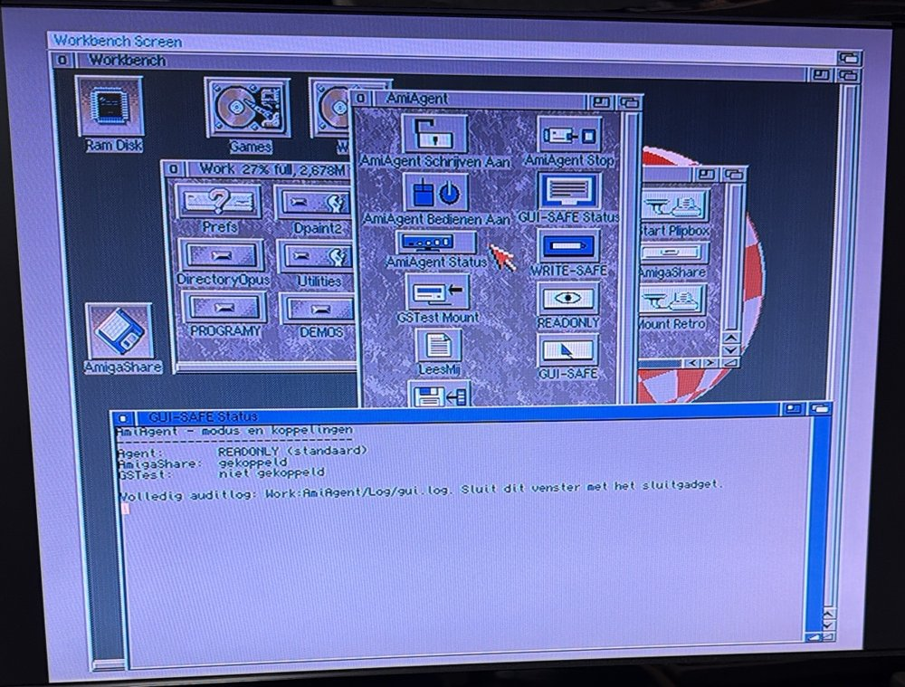
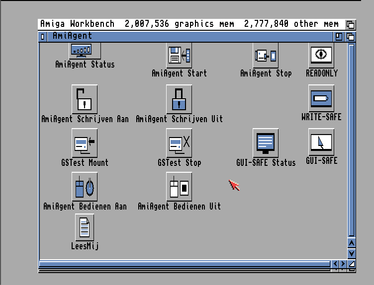
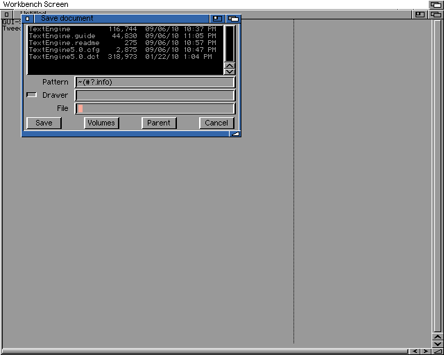
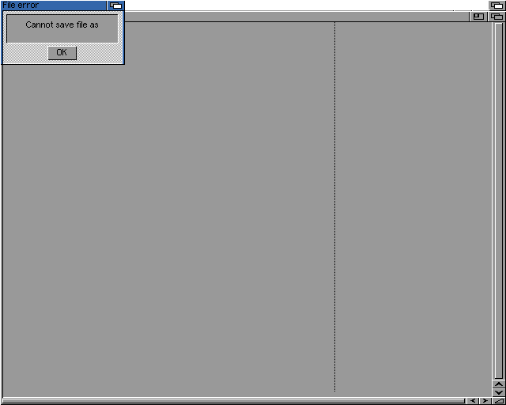
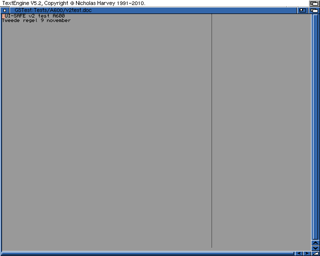

# AmiAgent A600 v2 – Gebruikershandleiding

| | |
|---|---|
| Documentversie | 1.0 |
| Datum | 08-11-2026 |
| Geldt voor | AmiAgent A600 v2 (scripts versie 2.0, geïnstalleerd en geaccepteerd op 08-11-2026) |
| Machine | Amiga 600, Workbench 3.1, IP-adres 192.168.1.60 |
| Doelgroep | Gebruiker aan de A600, zonder kennis van AmigaDOS of de Shell |

> **Status:** GUI-SAFE is op één echte Amiga 600 fysiek getest (acceptatietest 7/7 PASS), maar is **nog niet volledig beveiligingsgevalideerd**. Bekende afwijking: de `CLIENT`-instelling in het GUI-SAFE-mandaat wordt nog niet als IP-restrictie afgedwongen (zie [Issue 0004](../../../../docs/issues/0004-guisafe-client-not-enforced.md)). IP-adressen in dit document zijn voorbeelden (192.168.1.x).

**Wijzigingshistorie**

| Versie | Datum | Wijziging |
|---|---|---|
| 1.0 | 08-11-2026 | Eerste uitgave, na de geslaagde fysieke acceptatietest (7/7 PASS) |

---

## 1. Wat is AmiAgent?

AmiAgent is een klein programma op de A600 waarmee een AI-assistent (Claude) via het thuisnetwerk naar de Amiga kan
kijken en, alleen als **jij** dat aan de A600 toestaat, een beperkte taak mag uitvoeren.

- Claude draait op de Raspberry Pi (de "Pi-server", 192.168.1.145). De Pi praat met AmiAgent op de A600.
- Alles wat Claude mag, wordt **op de Amiga zelf** bepaald. Extra rechten geef je alleen lokaal: door aan de A600 op een
  pictogram te dubbelklikken en een vraag met **Ja** te beantwoorden. Claude kan zichzelf geen rechten geven.
- Er is altijd maar één AmiAgent tegelijk actief, in één van drie modi.

## 2. De drie modi

| Modus | Wat Claude kan | Hoe aan | Hoe uit | Duur |
|---|---|---|---|---|
| **READONLY** (standaard) | Kijken: systeeminformatie, mappen en bestanden lezen, schermafdrukken, vensters en menu's bekijken, de opdrachten Avail, Version en ShowConfig | AmiAgent Start | AmiAgent Stop | Tot je stopt of de A600 uitzet |
| **WRITE-SAFE** | Daarbovenop: **nieuwe** bestanden in de map `Work:Inbox` zetten. Niets overschrijven, geen Shell | Schrijven Aan + **Ja** | Schrijven Uit | Max. 30 minuten, max. 20 bestanden van elk max. 1024 KB |
| **GUI-SAFE** | Eén toegestaan programma (TextEngine 5.2) starten en bedienen met muis en toetsenbord; opslaan alleen in de testmap `GSTest:Tests/A600` | Bedienen Aan + **Ja** | Bedienen Uit | Max. 15 minuten, max. 300 handelingen |

> **Let op:** WRITE-SAFE en GUI-SAFE kunnen niet tegelijk aan staan. Na WRITE-SAFE of GUI-SAFE start het script weer READONLY (dat lukt alleen als het netwerk werkt; anders meldt het script dat).

Wat Claude in **geen enkele** modus kan: willekeurige Shell-opdrachten, ARexx-programma's, bestanden verwijderen of
overschrijven, systeeminstellingen wijzigen, of zichzelf een andere modus geven.

## 3. Het AmiAgent-venster en de pictogrammen

Open **Work** en daarin **AmiAgent**. Alle bediening gaat met een **dubbelklik**; je hebt geen Shell nodig.

*Foto van de echte A600 na de installatie. De pictogrammen staan in twee kolommen omdat na de installatie
"Clean Up" is gebruikt; dat is in orde (zie 3.2). Het venster is hoger dan het scherm: Schrijven Uit, GSTest Stop,
Bedienen Uit en AmiAgent Start staan verder naar beneden (gebruik de schuifbalk rechts).*

### 3.1 Alle pictogrammen

| Pictogram | Modus | Wat het doet bij dubbelklikken | Verandert iets? |
|---|---|---|---|
| **AmiAgent Status** (statusbalk) | READONLY | Venster met wat de agent nu doet (modus, verbonden computer, looptijd) | Nee |
| **AmiAgent Start** (diskette met pijl) | READONLY | Start de READONLY-agent. Vereist een draaiend netwerk | Start de agent |
| **AmiAgent Stop** | READONLY | Stopt de agent. Netwerk en gedeelde schijven blijven werken | Stopt de agent |
| **LeesMij** (blad papier) | READONLY | Korte uitleg over AmiAgent | Nee |
| **READONLY** (bord met oog) | uitleg | Toont een melding met uitleg over deze modus | Nee |
| **AmiAgent Schrijven Aan** (open hangslot) | WRITE-SAFE | Vraagt of Claude tijdelijk mag schrijven (Ja/Nee) | Ja, na **Ja** |
| **AmiAgent Schrijven Uit** (dicht hangslot) | WRITE-SAFE | Beëindigt het schrijven en zet READONLY terug | Ja |
| **WRITE-SAFE** (blauw bord met potlood) | uitleg | Uitleg over deze modus | Nee |
| **GSTest Mount** (schijf met pijl) | GUI-SAFE | Koppelt de testschijf `GSTest:` | Koppelt GSTest |
| **GSTest Stop** (schijf met kruis) | GUI-SAFE | Ontkoppelt `GSTest:` (weigert zolang hij in gebruik is) | Ontkoppelt GSTest |
| **GUI-SAFE Status** (monitor) | GUI-SAFE | Venster: welke modus, of AmigaShare en GSTest gekoppeld zijn, laatste meldingen | Nee |
| **AmiAgent Bedienen Aan** (muis + aan-knop) | GUI-SAFE | Controleert alles en vraagt of Claude het programma mag bedienen (Ja/Nee) | Ja, na **Ja** |
| **AmiAgent Bedienen Uit** (muis + stopknop) | GUI-SAFE | Noodstop: beëindigt de bediening en zet READONLY terug | Ja |
| **GUI-SAFE** (bord met muisaanwijzer) | uitleg | Uitleg met de juiste volgorde van de stappen | Nee |

Een venster met tekst (zoals GUI-SAFE Status) sluit je met het **kleine vakje linksboven** in de titelbalk van dat venster.

### 3.2 Indeling van de pictogrammen

Het pakket leverde een raster (rij READONLY, rij WRITE-SAFE, twee rijen GUI-SAFE, borden rechts):

Op de A600 is daarna **Clean Up** gebruikt; de pictogrammen staan nu in twee kolommen. De werking is precies gelijk.
Wil je het raster terug, vraag dat dan apart; het gaat om het opnieuw kopiëren van de pictogrambestanden.

> **Tip:** gebruik in het AmiAgent-venster liever geen *Clean Up* of *Snapshot* als je de indeling wilt bewaren.

## 4. Dagelijks gebruik

### 4.1 Opstarten

1. Zet de A600 aan en wacht tot Workbench er staat. **Plaats geen Gotek/DF0-image** als je GUI-SAFE wilt gebruiken.
2. Start het netwerk zoals je gewend bent (bijvoorbeeld Start Plipbox).
3. Work → AmigaShare → dubbelklik **AmigaShare Mount** → **OK**.
4. Work → AmiAgent → dubbelklik **AmiAgent Start** → **OK**. AmiAgent draait nu in READONLY.

AmiAgent start **nooit vanzelf**; na het aanzetten van de A600 moet je stap 4 altijd zelf doen.

### 4.2 Afsluiten

1. Zorg dat WRITE-SAFE en GUI-SAFE uit staan (dubbelklik **GUI-SAFE Status**: "Agent: READONLY").
2. Dubbelklik **AmiAgent Stop** → **OK** (optioneel).
3. Zet de A600 uit. Bij uitzetten vervallen alle mandaten en koppelingen.

## 5. GUI-SAFE: Claude een programma laten bedienen

GUI-SAFE geeft Claude tijdelijk de muis en het toetsenbord, maar alleen voor **TextEngine 5.2** en alleen zolang
TextEngine het actieve venster is. Je eigen schijven (Work, Games) zijn tijdens de sessie **schrijfbeveiligd**.

> **Waarschuwing**
> - Werp vóór GUI-SAFE een eventueel Gotek/DF0-image uit. Een diskette-volume kan niet beveiligd worden; dan weigert
>   GUI-SAFE te starten (dat is de bedoeling).
> - Wissel tijdens GUI-SAFE geen diskettes of images.
> - Raak tijdens de sessie de muis en het toetsenbord van de A600 niet aan, tenzij je wilt stoppen: zodra een ander
>   venster actief wordt, sluit GUI-SAFE de sessie (focusverlies). Dat is veilig, maar de test is dan voorbij.

### 5.1 Voorbereiden (volgorde is belangrijk)

1. Dubbelklik **GUI-SAFE Status**. Verwacht: Agent READONLY, AmigaShare gekoppeld, GSTest niet gekoppeld. Sluit het venster.
2. Work → AmigaShare → dubbelklik **AmigaShare Stop** → **OK**. (GUI-SAFE weigert zolang AmigaShare gekoppeld is.)
3. Work → AmiAgent → dubbelklik **GSTest Mount**. Na hooguit een minuut: "GSTest: is gekoppeld" → **OK**.

### 5.2 Activeren

4. Dubbelklik **AmiAgent Bedienen Aan**. De vraag "Bediening toestaan?" verschijnt met de grenzen
   (TextEngine, testmap GSTest:Tests/A600, 15 min, max 300 acties).
5. Klik **Ja**. Klik je **Nee**, dan verandert er niets.
6. Laat muis en toetsenbord los. Claude start nu zelf TextEngine en voert de taak uit.

Bedienen Aan controleert vóór de vraag (en na **Ja** nog een keer): dat GUI-SAFE en WRITE-SAFE nog niet actief zijn,
dat AmigaShare ontkoppeld is en dat GSTest goed gekoppeld is. Klopt iets niet, dan verschijnt
"GUI-SAFE NIET gestart" met de reden, en blijft READONLY gewoon actief.

### 5.3 TextEngine 5.2 en de juiste opslagprocedure

Claude (of jij, als je het zelf wilt proberen) slaat een **nieuw** document altijd op met **Save As**:

1. Toets **rechter Amiga + A** (Save As). Het venster "Save document" opent.
2. Typ bij *File* het volledige pad, bijvoorbeeld `GSTest:Tests/A600/mijntekst.doc`.
3. Druk **twee keer Return** (de eerste keer zet het venster het pad om, de tweede keer slaat hij op).

> **Let op:** gebruik voor een nieuw ("Untitled") document **niet** rechter Amiga + S. TextEngine probeert dan op te slaan
> in zijn eigen programmamap. Die map is op de server alleen-lezen; je krijgt "File error – Cannot save file as".
> Er wordt niets geschreven. Klik **OK** en gebruik Save As. Dit gebeurde tijdens de acceptatietest (zie hieronder).

Openen: **rechter Amiga + O**, pad typen, twee keer Return. Afsluiten: **rechter Amiga + Q** en **OK** bij "Are you sure?".

### 5.4 Beëindigen

7. Klik op het kleine dubbele vakje rechtsboven in het TextEngine-venster (diepteknop), of sluit TextEngine.
   De sessie sluit dan vanzelf.
8. Work → AmiAgent → dubbelklik **AmiAgent Bedienen Uit**. Wacht op "GUI-SAFE is uitgeschakeld" → **OK**.
   READONLY draait weer en je schijven zijn weer schrijfbaar.
9. Sluit TextEngine als het nog open is (rechter Amiga + Q, **OK**).
10. Dubbelklik **GSTest Stop** → "GSTest: is ontkoppeld" → **OK**.
11. Work → AmigaShare → dubbelklik **AmigaShare Mount** → **OK**.
12. Controle: **GUI-SAFE Status** toont Agent READONLY, AmigaShare gekoppeld, GSTest niet gekoppeld.

**De sessie stopt ook vanzelf** als de 15 minuten om zijn, na 300 handelingen, als Claude 2 minuten niets doet
(bijvoorbeeld bij netwerkverlies), bij focusverlies, of als er iets verandert in een bewaakte systeemmap. In al die
gevallen keert READONLY terug zodra TextEngine is afgesloten. Je schijven blijven beveiligd zolang TextEngine nog draait.

## 6. WRITE-SAFE: Claude bestanden laten afleveren

1. Zorg dat AmigaShare gekoppeld is en GUI-SAFE uit staat.
2. Dubbelklik **AmiAgent Schrijven Aan** → **Ja** → **OK** bij "WRITE-SAFE is actief".
3. Claude zet nieuwe bestanden in `Work:Inbox` (max. 30 minuten, 20 bestanden, 1024 KB per bestand).
4. Klaar? Dubbelklik **AmiAgent Schrijven Uit** → **OK**. READONLY draait weer.

## 7. Meldingen en wat je dan doet

| Melding | Betekenis | Wat te doen |
|---|---|---|
| GUI-SAFE NIET gestart – AmigaShare: is nog gekoppeld | Volgorde niet gevolgd | AmigaShare Stop, daarna opnieuw |
| GUI-SAFE NIET gestart – GSTest: is niet (geregistreerd) gekoppeld | GSTest ontbreekt | GSTest Mount, daarna opnieuw |
| GUI-SAFE NIET gestart – WRITE-SAFE is actief | Andere modus aan | Schrijven Uit, daarna opnieuw |
| GUI-SAFE is al actief; tweede activering geweigerd | Dubbelklik herhaald | Niets; of Bedienen Uit |
| Geen mandaat gegeven; er is niets gewijzigd | Je koos Nee | Niets |
| WRITE-SAFE niet gestart – GUI-SAFE is actief | Andere modus aan | Bedienen Uit, daarna opnieuw |
| GSTest: NIET gekoppeld – Stop eerst AmigaShare | Volgorde | AmigaShare Stop, daarna GSTest Mount |
| GSTest: is al gekoppeld | Dubbelklik herhaald | Niets |
| GSTest: bestaat zonder registratie | Oude koppeling (van vóór v2) | A600 uit- en aanzetten |
| GSTest: NIET ontkoppeld – GUI-SAFE is nog actief | Eerst stoppen | Bedienen Uit, daarna GSTest Stop |
| GSTest: NIET ontkoppeld: nog in gebruik | Er is nog een venster/programma op GSTest open | Sluit TextEngine en vensters van GSTest, daarna opnieuw |
| GUI-SAFE reageert niet op Ctrl-C | Agent hangt | Later opnieuw Bedienen Uit; anders A600 uitzetten (beveiliging vervalt dan) |
| GUI-SAFE is gestopt, maar de READONLY-agent start niet | Netwerk weg | Netwerk controleren, dan AmiAgent Start |
| File error – Cannot save file as (in TextEngine) | Opslaan buiten de testmap geweigerd | OK, daarna Save As met pad in `GSTest:Tests/A600` |
| Systeemmelding "write protected" | Iets probeerde op een beveiligde schijf te schrijven | Annuleren (Cancel). Dat is de beveiliging die werkt |

**Algemene veilige herstelstap:** dubbelklik **AmiAgent Bedienen Uit** (of **Schrijven Uit**). Helpt dat niet, zet de
A600 uit en weer aan: alle mandaten en koppelingen vervallen; start daarna normaal op (hoofdstuk 4.1).

## 8. Installatie, versie en terugzetten

- **Versie controleren:** in Work:AmiAgent staat het bestand `Versie-v2` (zichtbaar via *Window → Show → All Files*).
- **Installatiepakket:** op AmigaShare in `AmiAgent-v2/a600`. Die mappen hebben geen pictogram: kies in het
  AmigaShare-venster *Window → Show → All Files* om ze te zien.
- **Terugzetten naar de vorige versie:** sluit het AmiAgent-venster, open AmigaShare → AmiAgent-v2 → a600 en dubbelklik
  **AmiAgent v2 Herstellen** → **Herstellen** → **OK**. De back-up staat in `Work:AmiAgent/Backup-v1` en blijft bewaard.
  Doe dit alleen in overleg; daarna ontbreken GSTest Stop en de v2-verbeteringen.

## 9. Wat de AI wel en niet mag

**Wel:** in READONLY kijken en lezen; in WRITE-SAFE (na jouw Ja) nieuwe bestanden in Work:Inbox zetten; in GUI-SAFE (na
jouw Ja) TextEngine starten, typen, klikken in TextEngine en opslaan in de testmap.

**Niet:** zelf een modus aanzetten; de Shell gebruiken; andere programma's starten; buiten TextEngine klikken of typen;
schrijven op Work of Games tijdens GUI-SAFE; bestanden overschrijven of verwijderen; het Token of wachtwoorden lezen;
instellingen, Samba of andere Amiga's wijzigen.

> Het Token in `Work:AmiAgent/Prefs/Token` en het GSTest-wachtwoord in `Work:AmiAgent/Prefs/GSTestWachtwoord`
> deel je met niemand. AmiAgent is alleen bedoeld voor het eigen thuisnetwerk.

## 10. Acceptatietest 08-11-2026 (samenvatting)

| Stap | Resultaat |
|---|---|
| 1. Uitgangssituatie (READONLY, AmigaShare aan, GSTest uit, WRITE-SAFE uit) | PASS |
| 2. AmigaShare Stop → GSTest Mount → Bedienen Aan (Ja) | PASS |
| 3. TextEngine starten, typen, opslaan, sluiten, heropenen | PASS – eerste opslagpoging met rechter Amiga + S **geweigerd** door de server (niets geschreven); daarna Save As geslaagd |
| 4. Work: schrijfbeveiligd tijdens GUI-SAFE | PASS (vastgesteld via het logboek van de agent) |
| 5. Bedienen Uit → READONLY terug | PASS |
| 6. GSTest Stop → GSTest ontkoppeld | PASS |
| 7. AmigaShare Mount, eindtoestand | PASS |

