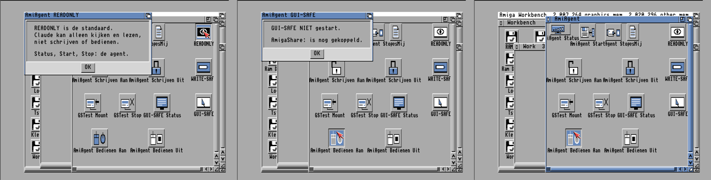
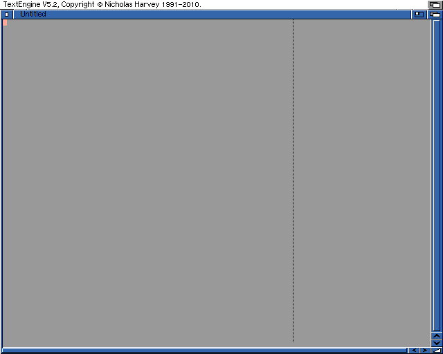

# AmiAgent A600 v2 – Technische handleiding

| | |
|---|---|
| Documentversie | 1.0 |
| Datum | 08-11-2026 |
| Geldt voor | AmiAgent A600 v2: scripts 2.0, Schrijven Aan 1.2, binaries ongewijzigd (zie 3) |
| Doelgroep | Beheerder / ontwikkelaar (Pi-zijde en AmigaDOS) |
| Bronnen | Deze map (`amiga/a600/AmiAgent-GuiSafe/`), [`../AmiAgent-WriteSafe/`](../../AmiAgent-WriteSafe/), [`../../a500-pistorm/AmiAgent/`](../../../a500-pistorm/AmiAgent/) |

> **Status:** GUI-SAFE is op één echte Amiga 600 fysiek getest (acceptatietest 7/7 PASS), maar is **nog niet volledig beveiligingsgevalideerd**. Bekende afwijking: de `CLIENT`-instelling in het GUI-SAFE-mandaat wordt nog niet als IP-restrictie afgedwongen (zie [Issue 0004](../../../../docs/issues/0004-guisafe-client-not-enforced.md)). IP-adressen in dit document zijn voorbeelden (192.168.1.x).

**Wijzigingshistorie**

| Versie | Datum | Wijziging |
|---|---|---|
| 1.0 | 08-11-2026 | Eerste uitgave na fysieke acceptatie v2 (7/7 PASS) |

**Statuslabels in dit document:** **[GETEST-FYSIEK]** op de echte A600 aangetoond · **[GETEST-EMU]** alleen in de
emulator (A600-profiel) aangetoond · **[GEÏMPLEMENTEERD]** aanwezig in code/scripts maar niet afzonderlijk getest ·
**[ONTWERP]** toekomstig, niet gebouwd.

Geen tokens, wachtwoorden of andere geheimen staan in dit document; alleen hun bestandsnamen.

---

## 1. Architectuur

```
 Claude Code (Pi 192.168.1.145)
   ├─ MCP amiga-a600     → amimcp-lsn (amimcp-ro.py, READONLY-clientfilter, auditlog)
   ├─ MCP amiga-a600-ws  → amimcp-ws-lsn (amimcp-ws.py, WRITE-SAFE staging, auditlog)
   └─ GUI-SAFE: geen MCP-registratie; bediening via een klein Python-testscript met upstream amiga.py (niet gepubliceerd)
            │  TCP 7846, eigen binair protocol, token per verzoek (onversleuteld, alleen thuisnetwerk)
            ▼
 A600 (192.168.1.60, 68000, KS/WB 3.1, AmiTCP 3.0b2 via Plipbox/Wi-Fi)
   één proces op poort 7846: amiagent (READONLY) | amiagent-ws (WRITE-SAFE) | amiagent-gs (GUI-SAFE)
   lokale scripts (IconX) beslissen welke binary draait; mandaten alleen lokaal
            │ smbfs 2.22 (NT1)
            ▼
 Samba op de Pi: [AmigaShare] (productie)  ·  [GuiSafeTest] (geïsoleerde testshare, gebruiker gstest)
```

- Basis: amiagent 0.13.2 (amimcp, Apache-2.0). LSN-patches: 0001 AmiTCP 3.0b2 (bsdsocket v3), 0002 READONLY,
  0003 token uit bestand. GUI-SAFE: `patches/0005-guisafe.patch` + `src/guisafe.c`, alleen in de build met
  `-DAMIAGENT_GUISAFE`. De Pi-filters zijn **geen** beveiligingsgrens; alle regels die tellen worden op de Amiga afgedwongen.
- Het token staat op de Amiga in `Work:AmiAgent/Prefs/Token` (protectie r) en op de Pi in een tokenbestand met modus 600 buiten de repository. Alle drie binaries gebruiken hetzelfde tokenbestand.
- De lokale statusbord-semafoor `amiagent.status` wordt door elke variant gevuld; `AmiAgent Status` (amimon) leest die.

## 2. Toestandsmachine

| Van | Gebeurtenis (lokaal) | Naar | Voorwaarden (afgedwongen door) |
|---|---|---|---|
| geen agent | AmiAgent Start | READONLY | netwerk aanwezig, binary + token aanwezig (script) |
| READONLY | Schrijven Aan + Ja | WRITE-SAFE | geen amiagent-gs (1.2-guard, 2×), geen 2e WS, netwerk; WS-binary weigert ongeldig mandaat (fail-closed → READONLY terug) |
| READONLY | Bedienen Aan + Ja | GUI-SAFE | geen amiagent-gs/-ws, AmigaShare: niet gekoppeld, `ENV:smbfs-process/GSTESTSMB` + `GSTest:` aanwezig; alles opnieuw na Ja; daarna pas READONLY stoppen (script). Binary: mandaatcontroles (zie 4) |
| WRITE-SAFE | Schrijven Uit, tijd/aantal op | READONLY | script start READONLY |
| GUI-SAFE | Bedienen Uit (Break C) | READONLY | agent geeft volumes vrij; Aan-script start READONLY als die niet draait; Uit-script start READONLY zelf na 10 s (niet als WS draait) |
| GUI-SAFE open | tijd (GUIMIN), handelingen (GUIMAX), idle (IDLESEC), focusverlies (2 ticks), tripwire, GSEND | GUI-SAFE dicht | binary; verdere invoer geweigerd; agent eindigt zodra het programma weg is, volumes tot dan beveiligd |
| GUI-SAFE dicht | programma afgesloten | READONLY | agent stopt (`SESSIE-DICHT`, `VRIJGEGEVEN`), Aan-script start READONLY |
| elke | stroomuitval / reset | geen agent | alles in RAM vervalt; AmiAgent start nooit automatisch |

Exclusie: alle varianten binden poort 7846; de scripts controleren bovendien expliciet op het andere proces
(`Status COMMAND=...`). **[GETEST-EMU]** V4b, V9; fysiek alleen de normale paden **[GETEST-FYSIEK]**.

## 3. Bestanden op de A600 (na installatie v2, gecontroleerd 08-11-2026)

| Pad (Work:AmiAgent/…) | sha256 (begin) | Rol | v2 |
|---|---|---|---|
| amiagent | bb2f0daf | READONLY-binary (89608 B) | ongewijzigd |
| amiagent-ws | 202f731f | WRITE-SAFE-binary | ongewijzigd |
| amiagent-gs | 34c74cf7 | GUI-SAFE-binary (100736 B) | ongewijzigd |
| AmiAgent Status | 844f8dee | amimon (statusvenster) | ongewijzigd |
| AmiAgent Start / Stop | f147ee5c / 193bfb2a | READONLY aan/uit | ongewijzigd |
| AmiAgent Schrijven Aan | eb8891a5 | 1.2: 1.1 + GUI-SAFE-guard | gewijzigd |
| AmiAgent Schrijven Uit | bc88be39 | 1.1 | ongewijzigd |
| AmiAgent Bedienen Aan | a717beab | 2.0 | gewijzigd |
| AmiAgent Bedienen Uit | 3a12418d | 2.0 | gewijzigd |
| GSTest Mount | 4e4d9701 | 2.0 (SETENV) | gewijzigd |
| GSTest Stop | 4e75c829 | 2.0 | nieuw |
| GUI-SAFE Status | 9cb0cea4 | 2.0, alleen lezen | nieuw |
| READONLY / WRITE-SAFE / GUI-SAFE | ee6d4eb7 / 685f74e4 / 9f170a19 | uitlegmeldingen (RequestChoice) | nieuw |
| *.info (14) | – | pictogrammen (IconX, STACK 16384) | nieuw of alleen positie; na *Clean Up* door Workbench herschreven (posities), afbeelding/tool/tooltypes = pakket |
| Versie-v2 | – | markering | nieuw |
| Backup-v1/ | – | 4 scripts, 6 .info, Lade-AmiAgent.bak | nieuw |
| Prefs/GuiMandaat, GuiAllow, GuiSafe | 1333fd60 / c2314462 / ee8389da | GUI-SAFE-configuratie (protectie r) | ongewijzigd |
| Prefs/writesafe | d0f69581 | WRITE-SAFE-startregel | ongewijzigd |
| Prefs/Token, Prefs/GSTestWachtwoord | niet gelezen | geheimen (protectie r) | ongewijzigd |
| C/Geladen, Docs/, Log/gui.log | – | hulpprogramma, licenties, auditlog | ongewijzigd |
| Schrijven-Aan.v1 / Schrijven-Uit.v1 | ade50977 / cf6b01d8 | verouderde WS-1.0-kopieën | blijven staan |

Overige paden: `Work:AmiAgent.info` (lade), `Work:AmigaShare/C/smbfs` (ook gebruikt door GSTest Mount),
`T:AmiAgent-gs.out` (uitvoer amiagent-gs), `RAM:AmiAgent-gs.log` (auditlog tijdens sessie), `ENV:smbfs-process/<DEVICE>`.

### 3.1 Configuratie GUI-SAFE (A600, lokaal)
`Prefs/GuiSafe`: `Work:AmiAgent/amiagent-gs TOKENFILE=Work:AmiAgent/Prefs/Token MANDATE=Work:AmiAgent/Prefs/GuiMandaat`

`Prefs/GuiMandaat` (KEY=VALUE, laatste voorkomen wint):
`APP=TextEngine`, `ALLOW=Work:AmiAgent/Prefs/GuiAllow`, `TESTDIR=GSTest:Tests/A600`, `CLIENT=192.168.1.145`,
`GUIMIN=15` (minuten, 1–30), `GUIMAX=300` (handelingen, 1–500), `IDLESEC=120` (10–600),
`PROTECT=Work,Games` (effectief; een eerdere regel met AmigaShare-Installatie wordt overschreven),
`EXEMPT=Ram Disk,GSTest`, `NOTIFY=SYS:S,SYS:C,ENVARC:`.

`Prefs/GuiAllow`: `TextEngine|GSTest:Programs/TextEngine5.2/TextEngine|GSTest:Programs/TextEngine5.2`.

### 3.2 Configuratie WRITE-SAFE
`Prefs/writesafe`: WRITEROOT=Work:Inbox, SRCROOT=AmigaShare:WriteSafe/a600, CLIENT=192.168.1.145, WRITEMIN=30,
WRITEMAX=20, MAXKB=1024, NOREAD=Work:AmigaShare/Prefs. WRITE-SAFE weigert verzoeken van een ander clientadres
(`WS:CLIENT`).

## 4. Autorisatie en afdwinging in GUI-SAFE

**Preventief (binary):**
- Mandaat alleen via het lokale bestand; ontbrekende of ongeldige waarden → geweigerd, `MANDAAT-GEWEIGERD` in het log.
  Programma en TESTDIR moeten bestaan; APP moet in de allowlist staan (allowlist één keer gelezen bij activering).
- **Volumedekking (fail-closed):** elk gekoppeld volume moet in PROTECT of EXEMPT staan; elk PROTECT-volume moet gekoppeld zijn.
- **Volumeprotectie:** `ACTION_WRITE_PROTECT` met een sleutel per volume, daarna een live probe (`<volume>:.gs-probe`
  aanmaken moet mislukken). Weigert het bestandssysteem of slaagt de probe → alle reeds beveiligde volumes vrijgegeven,
  mandaat geweigerd. Geldt voor elk proces (ook TextEngine en een Shell). **[GETEST-FYSIEK]** pilot (Gotek-volume
  geweigerd, Work-probe), v2 (`BESCHERMD Work/Games`).
- **LAUNCH:** alleen het allowlist-programma, via LoadSeg + CreateNewProc (geen Shell), één tegelijk, max. 3 keer per sessie.
- **Vensterbewaking:** klikken alleen op vensters van het programmaproces (`UserPort->mp_SigTask`, `WhichLayer`);
  toetsen/menu alleen als het actieve venster van het programma is.
- **Toetsfilter:** geweigerd: beide Amiga-toetsen, linker-Amiga-combinaties behalve LAmiga+V/B, de linker-Amiga-toets
  zelf, afdrukbare toetsen buiten TEXT. Rechter-Amiga-sneltoetsen van het programma zijn toegestaan.
- **Tekstfilter:** getypte tekst met `:` of `/` moet met TESTDIR beginnen (hoofdletterongevoelig), precies één `:`, geen `//`.
  Dekt **alleen getypte paden**, niet muisnavigatie in een bestandsvenster.
- **Limieten:** GUIMIN, GUIMAX, IDLESEC (elke geauthenticeerde aanvraag verlengt), focusverlies (2 ticks van ~2 s).
- READONLY-muur blijft: geen vrije EXEC, PUT, AREXX, UIACT, BREAK.

**Alleen detectie:**
- **Tripwire** (StartNotify op NOTIFY-mappen): sluit de sessie **na** een wijziging; voorkomt die niet.
- **Auditlog:** `RAM:AmiAgent-gs.log` tijdens de sessie, daarna toegevoegd aan `Work:AmiAgent/Log/gui.log`.
- Focusverlies-detectie: de wissel is al gebeurd; alleen verdere invoer wordt voorkomen.

**Niet afgedwongen (geïmplementeerd als registratie):** `CLIENT` in het GUI-SAFE-mandaat wordt gecontroleerd op lengte,
opgeslagen en gemeld, maar **niet** als IP-filter gebruikt (anders dan bij WRITE-SAFE). Toegang vereist wel het token.

## 5. Samba-isolatie GSTest (Pi)

Share `[GuiSafeTest]` (ingericht 08-11-2026, 32/32 controles PASS; voorbeeld: [`../samba/GuiSafeTest.example.conf`](../samba/GuiSafeTest.example.conf)):
- `path=<sharemap>`, `valid users=gstest`, `force user/group=gstest`, `browseable=no`, `guest ok=no`,
  `create mask=0640`, `directory mask=0750`, `hosts allow=192.168.1.60 192.168.1.227 127.0.0.1`,
  `follow symlinks=no`, `wide links=no`.
- Bestandsrechten: sharemap root 755; `Programs/` root (alleen-lezen voor gstest);
  `Tests/` root 755; `Tests/A600` en `Tests/PiStorm` gstest 750.
- Systeemgebruiker gstest (nologin, home /nonexistent); `invalid users = gstest` in `[printers]` en `[print$]`.
- Gevolg: TextEngine kan alleen in `Tests/A600` schrijven; schrijven in de programmamap wordt door de server
  geweigerd. **[GETEST-FYSIEK]** acceptatietest stap 3 (RAmiga+S op Untitled → "Cannot save file as", niets geschreven).

## 6. Mountregistratie en gecontroleerde unmount

- `GSTest Mount` 2.0 start `Work:AmigaShare/C/smbfs … VOLUME=GSTest DEVICE=GSTESTSMB PROTOCOL=nt1 SETENV`;
  smbfs schrijft dan zijn procesnummer in `ENV:smbfs-process/GSTESTSMB` (verdwijnt bij afsluiten). Het script wacht
  max. 60 s op dit bestand. Weigert bij: AmigaShare gekoppeld, al gekoppeld, ongeregistreerd `GSTest:`, geen netwerk,
  ontbrekend smbfs of wachtwoordbestand. Het wachtwoord gaat via een lokale variabele als argument naar smbfs
  (zelfde methode als AmigaShare Mount) en wordt direct daarna gewist.
- `GSTest Stop` 2.0: weigert tijdens GUI-SAFE; `Break <nr> C` tot 5× met 2 s; smbfs stopt niet zolang locks of
  bestanden open zijn → melding "nog in gebruik". **[GETEST-EMU]** V13 (open lock → geweigerd, daarna ontkoppeld);
  **[GETEST-FYSIEK]** normale ontkoppeling (stap 6).
- Les uit de pilot (0.1 zonder SETENV): smbfs maakt zich los van de CLI; zonder registratie is er geen procesnummer en
  blijft het volume tot uitschakelen.

## 7. Foutafhandeling en fail-closed

- Elke weigering in Bedienen Aan gebeurt **vóór** READONLY gestopt wordt (v2-correctie); READONLY blijft draaien.
- Faalt het starten van amiagent-gs (mandaat geweigerd), dan start het Aan-script READONLY opnieuw.
- WRITE-SAFE met ongeldig mandaat weigert en herstelt READONLY **[GETEST-EMU]** (run 1: ontbrekende NOREAD-map).
- Bedienen Uit: Break tot 15×; daarna READONLY-controle en zo nodig starten; meldt elk afwijkend resultaat.
- Geen script geeft bij een fout méér rechten: het eindpunt is READONLY of geen agent.

## 8. Installatie, checksums, back-up en rollback

- Pakket: 28 bestanden met `MANIFEST.sha256`, geplaatst in `AmigaShare:AmiAgent-v2/a600` (scripts en pictogrammen staan in deze map en in `install/`).
- `AmiAgent v2 Installeren`: weigert bij actieve WS/GS, ontbrekende installatie, bestaande `Backup-v1`, onvolledig pakket;
  vraagt bevestiging; back-up van 4 scripts, 6 .info en lade-pictogram; controleert de back-up; kopieert; schrijft `Versie-v2`.
- `AmiAgent v2 Herstellen`: zet back-up terug, verwijdert de 13 nieuwe bestanden; `Backup-v1` blijft.
- Kopieën zonder geheimen van de installatie vóór en na (met sha256) worden op de beheer-Pi bewaard.
- Verificatie gebeurt via de READONLY-route: sha256 per bestand, Token/wachtwoord overgeslagen.

## 9. Testresultaten

### 9.1 Emulator (A600-profiel: 68000, 2+4 MB, KS/WB 3.1, echte FFS-HDF's, echte smbfs naar test-Samba in netwerknamespace)

| Reeks | Inhoud | Uitkomst |
|---|---|---|
| Prototype G0–G3sc | mandaat, beveiliging, LAUNCH, typen/opslaan, weigeringen, CLI via programma, limieten, tripwire, script | G0 11/11, G1 35/35 (regressie op 34c74cf7), G2-reeks OK, G3 10/12 + SC1 6/6 (FOUT = harnasfouten) |
| v2test run 1 | V0–V15 | 23/25, **ongeldig voor V4** (testomgeving miste NOREAD-map) |
| v2test run 2 | V0–V15 | 24/25 (1 telfout: WS-melding nog open) |
| V4b | WS↔GS-exclusie, herhaald | 7/7 |
| Installatie I0–I5 | installeren op v1-kopie, dubbele installatie, herstellen | 9/9 (definitief pakket) |
| Workbench | lade, dubbelklik GUI-SAFE Status, uitlegbord, Bedienen Aan (weigering) | PASS (schermafdrukken) |



### 9.2 Fysiek (echte A600)

| Test | Datum | Uitkomst |
|---|---|---|
| Pilot GUI-SAFE (scripts 0.1) | 08-11-2026 | stap 0–10 PASS; stap 11 deels (GSTest niet te ontkoppelen, geen SETENV) |
| Installatie v2 | 08-11-2026 | PASS na herstart; alle scripts byte-gelijk; daarna *Clean Up* door gebruiker (alleen posities) |
| **Acceptatietest v2 (referentie)** | 08-11-2026 | **7/7 PASS** – zie hieronder |

Acceptatietest v2 (A600-klok 00:17–00:30; auditlog `Work:AmiAgent/Log/gui.log`):
1. Uitgangssituatie: READONLY, AmigaShare gekoppeld, GSTest niet, geen Gotek-volume – PASS.
2. AmigaShare Stop (registratie weg) → GSTest Mount (`ENV:smbfs-process/gstestsmb` aanwezig) → Bedienen Aan, Ja
   (`lsn1 GUI-SAFE`, `gui_protected=2`, ca. 15 min, 300 acties) – PASS.
3. LAUNCH TextEngine; tekst getypt; **RAmiga+S op "Untitled" → schrijfpoging in `GSTest:Programs/TextEngine5.2`
   door Samba geweigerd** ("Cannot save file as"; op de Pi gecontroleerd: niets geschreven); na akkoord gebruiker
   OK-klik en Save As (RAmiga+A, pad, 2× Return) → `GSTest:Tests/A600/v2test.doc` (2924 B, gstest); RAmiga+Q + OK;
   tweede LAUNCH; RAmiga+O → heropend met beide regels – PASS.
4. Work: schrijfbeveiligd – PASS via log `BESCHERMD Work/Games` (incl. live probe) en `gui_protected=2`; bewust geen
   nieuwe schrijfpoging buiten TESTDIR.
5. Bedienen Uit → `SESSIE-DICHT agent stopt`, `VRIJGEGEVEN Work/Games`, `lsn1 READONLY` – PASS.
   (TextEngine was eerder afgesloten: `PROGRAMMA-AFGESLOTEN 00:26:53`.)
6. GSTest Stop → volume en registratie weg – PASS.
7. AmigaShare Mount; eindtoestand: 62 bestanden byte-gelijk aan direct na installatie, amiagent bb2f0daf – PASS.



## 10. Beperkingen, risico's en niet-geteste situaties

1. EXEMPT-volumes (RAM:, GSTest:) worden niet door de agent beveiligd; GSTest is serverzijdig begrensd tot `Tests/A600`.
2. Geen geheugenbescherming op AmigaOS: malware op de Amiga kan agent, mandaat of sleutel aanpassen. Het model
   beschermt tegen een foute/misleide client, niet tegen kwaadaardige code op de Amiga.
3. De write-protect-sleutel is pseudo-willekeurig (tijd/adres).
4. Race: tussen vensterbewaking en Intuition kan de focus in theorie (ms-orde) wisselen.
5. Stroomuitval tijdens een sessie: beveiliging vervalt (RAM) + normaal FFS-validatierisico. Er is **geen CF-back-up**
   (bewust geaccepteerd risico).
6. Verwisselbare media (Gotek/DF0) ondersteunen geen write-protect → GUI-SAFE weigert; vooraf uitwerpen.
7. Token gaat onversleuteld over het thuisnetwerk.
8. `CLIENT` niet afgedwongen in GUI-SAFE (zie 4).
9. Lokaal GuiMandaat bevat een losse regel `PROTECT Work,Games` (zonder `=`, genegeerd) en een eerdere
   PROTECT-regel met AmigaShare-Installatie die door de laatste regel wordt overschreven.

**Geïmplementeerd maar niet fysiek getest:** WRITE-SAFE↔GUI-SAFE-exclusie in beide richtingen; GSTest Stop met open
bestanden; Bedienen Aan-weigeringen (AmigaShare, WS, zonder GSTest); automatische sessie-einden door tijd, idle,
actielimiet en tripwire op de A600 (wel emulator); Herstellen-script op de A600; Bedienen Uit-pad "READONLY start zelf".

**Niet getest:** GUI-SAFE op de PiStorm/CaffeineOS (ondersteuning ACTION_WRITE_PROTECT door PFS3/SFS onbekend);
andere programma's dan TextEngine; langere sessies dan ~10 minuten.

**[ONTWERP] / open:** MCP-registratie van GUI-SAFE; PiStorm-pilot (voorwaarden: SD-image, FS-check, eigen mandaat);
opschonen lokaal GuiMandaat; terugzetten rasterindeling.

## 11. Onderhoud en toekomstige versies

1. **Inventaris eerst** via READONLY (sha256, geheimen overslaan).
2. **Nooit** de READONLY-binary wijzigen: build-controle tegen `bb2f0daf…` (build-script van AmiAgent).
3. Nieuwe scripts: AmigaDOS-regels < 255 tekens (ook na variabele-expansie); `Echo` met `=` tussen aanhalingstekens;
   geen `Lab` binnen IF-blokken voor terugsprongen.
4. Testen: eerst in een emulator met A600-profiel (Amiberry, stoppen via IPC QUIT, nooit hard), met een test-Samba in een eigen netwerknamespace. Daarna fysieke acceptatie met de gebruiker, stap voor stap.
5. Pakket met `MANIFEST.sha256`, installatiescript met back-up en weigering bij bestaande back-up; herstelscript.
6. Na installatie: sha256-controle via READONLY tegen pakket en inventaris.
7. Pictogrammen: bij bestaande .info alleen de positie (do_CurrentX/Y) wijzigen.
8. Documentatie en geheugen bijwerken; versienummer verhogen ($VER-regel en dit document).
