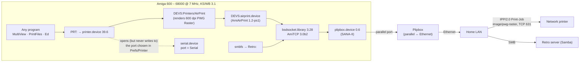

# Amiga 600: direct IPP printing over a Plipbox, no accelerator

A stock Amiga 600 prints straight to a modern network printer:
- **CPU:** 68000 at 7 MHz;
- **RAM:** 2 MB chip and 4 MB fast;
- **OS:** Kickstart and Workbench 3.1;
- **network:** AmiTCP 3.0b2 and a Plipbox on the parallel port;
- **print path:** no PC, no Raspberry Pi and no print server.

Every Workbench program that prints through `PRT:` works without changes: MultiView, PrintFiles, Ed, and others.

| | |
|---|---|
| Status | ✅ **Proven on real hardware** (16-10-2026, all 8 steps). The public ADF was retested in a clean emulator on 17-10-2026. |
| Package | `A600AirPrint` 1.0, contained in `A600AirPrint-public.adf` |
| Language of the Amiga scripts | Dutch. The scripts are the tested originals and are deliberately left untranslated. This page explains every message. |

## Architecture



### Why the printer port is set to *Serial*

`printer.device` always opens the port selected in Prefs/Printer, even when the driver does not use it.
- The Plipbox holds the parallel port, so choosing *Parallel* fails.
- The AirPrint driver sends its data over TCP/IP. It **never writes to the serial port**: in the emulator, 0 bytes reached the serial line during 8 print jobs.
- **Consequence:** while a page prints, no other program can open the serial port, and printing waits until the serial port is free.

### About the name "AirPrint"

The package names come from [AmiAirPrint](https://github.com/Andiweli/AmiAirprint), on which this work is based. The route uses the open standards IPP/2.0 and PWG Raster (`image/pwg-raster`). It is not supported or certified by Apple.

## Requirements

| Item | Tested with | Notes |
|---|---|---|
| Amiga 600, 68000 | 7 MHz, no accelerator | Any OS 3.1 Amiga with a working AmiTCP setup should work. |
| Memory | 2 MB chip + 4 MB fast | With AmiTCP running, 2.98 MB fast was free. **Fast RAM is needed for colour pages**: chip RAM only was enough for text, but a colour page failed in the emulator. |
| Kickstart / Workbench | 40.63 / 40.42 (3.1) | Not included. Use your own copy. |
| printer.device | 39.6 | The installer refuses version 42 and later (V42Printer setups). |
| TCP/IP | AmiTCP 3.0b2 (bsdsocket.library 3.28) | Not included (GPL-2.0). See [`THIRD_PARTY.md`](../../THIRD_PARTY.md). |
| Network | Plipbox with plipbox.device 0.6 | See [`networking/`](../../networking/). |
| Printer | IPP printer that accepts PWG Raster at 600 dpi, sgray_8/srgb_8 | Tested with a Brother MFC-L8390CDW. |
| Disk space | 284 KB on `SYS:`, 106 KB on `Work:` | |
| Floppy | an ADF on a Gotek, or a real disk | The installer runs from Workbench, not from a boot disk. |

## Build the disk for your printer

The release ADF uses the placeholder printer address `192.168.1.50`. Either rebuild it with your own address, or install it unchanged and set the address afterwards (step 6).

```sh
pip install amitools                      # provides xdftool
cd amiga/build
cp network.example.ini network.ini        # edit host/port/path; network.ini is git-ignored
python3 build_public.py --package a600 --config network.ini --out out/
```

The build script:
- fills the four tokens `@@PRINTER_NAME/HOST/PORT/PATH@@`;
- regenerates the checksum lists that the installer verifies;
- writes `out/A600AirPrint-public.adf` and reads every file back from it.

With the original home configuration, it reproduces the tested package **byte for byte**: 36 of 36 files identical. See [`tests/a600/`](../../tests/a600/).

## Install, verify, remove

Each step is a double-click on the floppy. Start the network first, the way you always do.

| # | Icon | What it does | Changes on disk |
|---|---|---|---|
| 0 | **Controle** | Read-only inventory. Reports:<br/>– Kickstart/Workbench and `printer.device` versions;<br/>– free fast RAM;<br/>– current printer choice;<br/>– serial/parallel port state;<br/>– network and `Retro:`;<br/>– free space;<br/>– leftovers of V42Printer or NetPar;<br/>– which startup files mention AmiTCP, plip or Retro (keywords only, the contents are never shown). | none (report in `RAM:`) |
| 1 | **Installeer** | **[1]** Checks first, and stops before changing anything if a check fails.<br/>**[2]** Backs up into `Work:AmiAirPrint-Backup`, and records 41 checksums of protected files (S:, DEVS:, L:, AmiTCP:, WBStartup).<br/>**[3]** Copies the files.<br/>**[4]** Verifies all 28 new files against their checksums. If [3] or [4] fails, it restores everything automatically. | adds only (list below) |
| 2 | *Prefs/Printer* | Choose printer type **AirPrint** and port **Serial**, then **Save** (not Use). | `ENVARC:Sys/printer.prefs` |
| 3 | reboot | Start the network as usual. | – |
| 4 | **ControleerPrinter** | Asks the printer for its IPP attributes. Prints nothing. Expect `[1] OK … IPP status 0x0000` and `[2] OK … PWG Raster`. | none |
| 5 | **TestTekst**, **TestGrafiek** | One text page (20–30 s), and one colour page (about 10–11 min at 7 MHz). | none |
| 6 | *SYS:Prefs/AmiAirPrint* | The official AmiAirPrint settings program: printer address, colour or grey, duplex, paper, scale.<br/>For a printer other than the one built into the disk, enter its address here and **Save**. ControleerPrinter then needs the address as an argument: `ControleerPrinter HOST=<ip>`. | `ENVARC:AirPrint.prefs` |

Files added by Installeer:
- `DEVS:airprint.device`
- `DEVS:Printers/AirPrint`
- `SYS:Prefs/AmiAirPrint` and its `.info` (the Classic version for OS 3.0/3.1)
- `ENVARC:AirPrint.prefs`
- `Work:A600AirPrint/`, which holds the tools, so the floppy is no longer needed
- `Work:AmiAirPrint-Backup/`

Installeer never touches the following:
- `Startup-Sequence`, `User-Startup`;
- `printer.device`, `parallel.device`, `serial.device`;
- `DEVS:Networks`, AmiTCP, the Plipbox files, RetroMount.

### Messages you may see (Dutch → meaning)

| Message | Meaning / action |
|---|---|
| `unable to open redirection file` during the port test | The port is busy. On the parallel port this is normal, because the Plipbox holds it. |
| `in Prefs/Printer staat poort Parallel` | The port is still set to Parallel. In Prefs/Printer choose Serial, then Save. |
| `de seriële poort is nu in gebruik` | A terminal, modem, MIDI or `AUX:` program has the serial port open. Close it first. |
| `het netwerk staat uit` | AmiTCP is not running. Start the network. |
| `Connection to printer timed out` | The printer is off, or the address is wrong. Check the address in SYS:Prefs/AmiAirPrint. |
| `GESTOPT: Work:AmiAirPrint-Backup bestaat al` | Already installed. Run Verwijderen first. |

## Remove and recover

| Situation | Action |
|---|---|
| Stop using AirPrint, keep the files | In Prefs/Printer, choose the previous driver and **Save**. |
| Remove completely | Double-click **Verwijderen** (in `Work:A600AirPrint` or on the floppy), then reboot.<br/>It:<br/>– restores every backed-up file;<br/>– deletes the new files;<br/>– restores the previous `printer.prefs` (or deletes it, if there was none);<br/>– compares the 41 protected checksums.<br/>Finally it renames the backup to `Work:AmiAirPrint-Backup.oud`, which you may delete. |
| The script cannot run | Run these commands by hand, then reboot:<br/>`Delete DEVS:airprint.device DEVS:Printers/AirPrint SYS:Prefs/AmiAirPrint SYS:Prefs/AmiAirPrint.info ENVARC:AirPrint.prefs`<br/>`Delete Work:A600AirPrint Work:A600AirPrint.info ALL`<br/>Then restore `Work:AmiAirPrint-Backup/prtprefs` to `ENVARC:Sys/printer.prefs`. If `prtprefs.nieuw` exists instead, delete `ENVARC:Sys/printer.prefs`. |
| Hang longer than 15 minutes | Reset the machine. Printing keeps its spool in memory, so nothing on disk changes. |

**Proof of reversibility (emulator):** after Verwijderen, every file on `SYS:` and `Work:` was bit-identical to the state before installation. The only addition was the `.oud` backup folder.

## Test results

| Test | Emulator (original package) | Emulator, clean, **public ADF** | Real A600 |
|---|---|---|---|
| Controle is read-only | 593 files, 0 differences | 593 files, 0 differences | ✅ |
| Install and verify the 28 files | ✅ | ✅ "28 ongewijzigd, 0 afwijkend", using lists regenerated by `build_public.py` | ✅ |
| ControleerPrinter | ✅ | ✅ (printer address taken from the build configuration) | ✅ |
| Text page via `PRT:` | 27 s | 28 s, job **byte-identical** (`df2bf769…`) | ✅ on paper |
| Colour page (MultiView) | 10 min 20 s – 10 min 40 s | 10 min 18 s, job **byte-identical** (`be169384…`) | ✅ on paper (> 8 min) |
| `Retro:` and plip0 during printing | ✅ | see [`tests/a600/`](../../tests/a600/) | ✅ browse and copy |
| PrintFiles, `Echo >PRT:` | ✅ | see tests | ✅ |
| Reboot keeps the settings | ✅ | see tests | ✅ |
| Verwijderen → 0 differences | ✅ | see tests | not run (installation kept) |
| Bytes sent to the serial port | 0 in 8 jobs | see tests | not measurable |

Details: [`tests/a600/`](../../tests/a600/). Photos: [`images/a600/`](../../images/a600/).

## Known limitations

- **Speed.** A colour page takes 10–11 minutes at 7 MHz; a text page 20–30 s. Greyscale is set in SYS:Prefs/AmiAirPrint and is expected to be faster; this was not measured.
- **Serial port.** The serial port is occupied while a page prints.
- **Network configuration.**
  - AmiTCP 3.0b2 has no DHCP client. Use a fixed address and a DHCP reservation for both the Amiga and the printer.
  - AmiTCP has no mDNS, so use the printer's IP address, not `printer.local`.
- **Hard-coded address check.** The `ControleerPrinter` icon checks the address that was built into the disk. For any other address, run it from a Shell with `HOST=`.
- **No clock.** The A600 has no real-time clock, so backup files get the 1978 date.
- **Prefs icon off-screen.** The official AmiAirPrint prefs icon has a fixed position in the Prefs drawer. If you cannot see it, use *Window → Clean Up*.
- **Large images.** Big pictures need more fast RAM. Only the included test image was measured.
- **Dutch texts.** All on-screen texts are in Dutch.

## Source and licences

| Part | Licence |
|---|---|
| Scripts, icons, test image, CRCLijst ([source](A600AirPrint/Docs/crclijst.c)) | MIT, this project |
| AmiAirPrint binaries (`Bestanden/`, `C/AirPrintProbe`), rebuilt from the MIT commit `f9cb9fd` with [`AmiAirPrint-1.2-ps1.diff`](A600AirPrint/Docs/AmiAirPrint-1.2-ps1.diff) | MIT, © Andreas Stürmer ([`AmiAirPrint-LICENSE`](A600AirPrint/Docs/AmiAirPrint-LICENSE)) |
| The two prefs programs | Official Aminet 1.2 files, with one byte changed to request bsdsocket V3 |

See [`printing/amiairprint/`](../../printing/amiairprint/).
