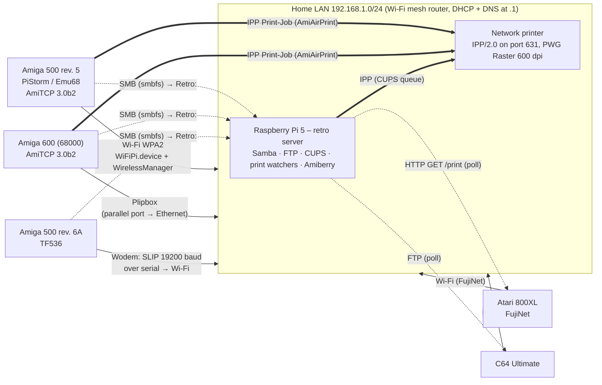

# Network architecture

Detailed diagrams: [retro server](../hardware/retroserver.md) · [A500 rev. 5 PiStorm](../../amiga/a500-pistorm/README.md#architecture) · [Amiga 600](../../amiga/a600/README.md#architecture) · [address plan](address-plan.md)

> Addresses are **examples** (`192.168.1.x`). Use your own LAN range and give fixed addresses a DHCP reservation in your router.

## Overview



## Design rules

| Rule | How it is applied |
|---|---|
| The Amigas print directly | AmiAirPrint renders on the Amiga and sends an IPP `Print-Job` with `image/pwg-raster` straight to the printer. The Pi is not involved. |
| The Pi is a helper, never a single point of failure for the Amigas | When the Pi is off, the Amigas still boot, network and print. Only Retro: (file sharing) is unavailable. |
| One network stack per Amiga | AmiTCP 3.0b2 everywhere: no DHCP, fixed addresses, the same `db/` layout. |
| Networking is started by hand | Icons such as *Start Plipbox*, *StartWiFi* or *Wodem Start* start it; startup-sequences are never edited. |
| File sharing is read-only by default | The Amigas log in as a restricted user on a read-only share (`AmigaLibrary`). Write access is a separate share with its own account, mounted only when needed. |
| Platform-native print emulation for 8-bit machines | FujiNet and the Ultimate emulate a printer and produce a PDF or PNG. A watcher on the Pi fetches it and passes it to CUPS. |

## Print routes

| Source | Route | Format | Status |
|---|---|---|---|
| Amiga (any app → `PRT:`) | printer.device 39.6 → `AirPrint` driver → airprint.device → bsdsocket → IPP | PWG Raster, sgray_8/srgb_8, 600 dpi | ✅ A500 PiStorm, ✅ A600 |
| Amiga, fallback via Pi | `NaarDePi` → SMB share → Pi spooler → CUPS | PostScript/text | 🧪 built, **not activated** |
| Atari 800XL | FujiNet printer emulation → HTTP `/print` (PDF) → watcher (45 s poll, SHA-1 dedup) → CUPS | PDF | ✅ |
| C64 Ultimate | Ultimate printer emulation → PNG on USB → FTP → spooler (30 s poll, double-download check) → CUPS | PNG | ✅ |
| C64 Meatloaf | SD card via HTTP → PDF repair → CUPS | PDF | 🛠️ installed, no recorded print |

## Storage layout on the server

```
/mnt/retro/
  retro-files/                  SMB "RetroFiles" (owner, read/write)
    Amiga/amiga/                SMB "AmigaLibrary" (Amiga user, read-only) = Retro: on the Amigas
      Games/ Tools/ System/ Network/ Hardware/ Docs/ Online/
    Atari 8-bit/ Atari ST/ Commodore 64/ Amstrad CPC/ ZX Spectrum/ Atari 2600/
      Games/ Tools/ System/ Docs/ Downloads/ (inbox)
    _Catalogus/                 generated game catalogues (PDF)
  printserver/                  SMB "PrintServer": spool drop for the Pi fallback route
  amiberry/                     emulator configs, HDFs, floppies (ROMs stay private)
```

`Online/` (BBS lists) is bind-mounted read-only into the Amiga tree, so the Amigas can read it but never change it.
