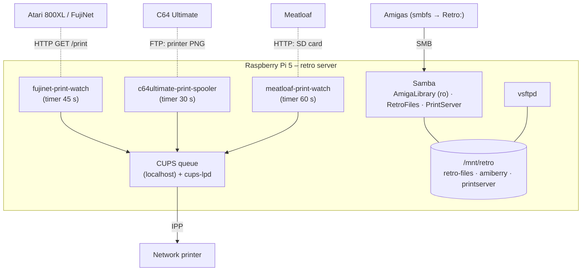

# Raspberry Pi 5 – retro server

| Item | Value |
|---|---|
| Hardware | Raspberry Pi 5, external USB disk mounted on `/mnt/retro` (458 GB) |
| OS | Debian 13 |
| Network | Wi-Fi on the home LAN. Its address should be reserved in the router. |

## Services

| Service | Purpose | Notes |
|---|---|---|
| Samba `AmigaLibrary` | `Retro:` on the Amigas | restricted Amiga user, **read-only**, path `retro-files/Amiga/amiga` |
| Samba `RetroFiles`, `Amiberry`, `PrintServer` | owner access, emulator files, spool drop | owner account, read/write |
| vsftpd | FTP for the 8-bit machines and the A600 FTP client | – |
| CUPS | one queue for the network printer | listens on localhost only; `cups-lpd.socket` serves legacy LPD clients |
| print watchers (systemd timers) | FujiNet every 45 s, C64 Ultimate every 30 s, Meatloaf every 60 s | see [`server/retro-print/`](../../server/retro-print/) |
| BBS list generator and gateway | ports 2323/6464/8023, LAN only | not part of this release |
| Amiberry 8.3.0 | emulator for development and tests | ROMs are never published |
| Avahi | mDNS on the LAN | – |

The Amigas do **not** depend on the server for networking or printing: they print directly to the printer. Only `Retro:` needs the server.

